# Логическая модель данных

Документ описывает логическую модель ключевых данных объединённой организации: состав сущностей, связи и их кратность, правила идентификации и принципы, по которым модель используется в переходный период и в целевом состоянии.

## 1. Назначение модели

Модель является канонической: она не повторяет структуру FU Core или RB Core, а задаёт единый язык данных, к которому приводятся данные обеих организаций. На её основе строятся:

- канонический формат сообщений в интеграционном слое;
- структура золотых записей в MDM;
- детальный слой DWH и очищенный слой Data Lakehouse;
- таблицы соответствия кодов и идентификаторов FU и RB.

## 2. Группы сущностей

| № | Группа | Сущности | Владелец данных (бизнес) |
| --- | --- | --- | --- |
| 1 | Участники | Клиент, Кросс-ссылка идентификаторов, Связь клиентов | Data Office совместно с розничным бизнесом и МСБ |
| 2 | Справочники | Клиентский сегмент, Подразделение, Продукт, Тариф | Продуктовые подразделения розницы и МСБ, сеть продаж |
| 3 | Соглашения | Договор, Счёт, Карта, Кредит | Розничный бизнес, МСБ, кредитные подразделения |
| 4 | Операции | Платёж, Операция | Операционный блок, финансовый департамент |
| 5 | Обслуживание | Обращение, Документ клиента | Контактный центр, операционный блок |

## 3. Связи и кратность

| № | Сущность A | Связь | Сущность B | Кратность | Комментарий |
| --- | --- | --- | --- | --- | --- |
| 1 | Клиент | идентифицируется в системах | Кросс-ссылка идентификаторов | 1 : 1..N | У каждой золотой записи минимум одна запись системы-источника |
| 2 | Клиент | связан с клиентом | Связь клиентов | N : M | Реализуется через сущность «Связь клиентов» с типом связи |
| 3 | Клиентский сегмент | классифицирует | Клиент | 1 : 0..N | Сегмент рассчитывается в MDM по единым правилам |
| 4 | Подразделение | обслуживает | Клиент | 1 : 0..N | Обслуживающее подразделение |
| 5 | Подразделение | входит в | Подразделение | 0..1 : 0..N | Иерархия подразделений |
| 6 | Продукт | имеет версии условий | Тариф | 1 : 1..N | Тариф версионируется периодом действия |
| 7 | Продукт | заменяется целевым | Продукт | 0..1 : 0..N | Сопоставление продукта RB целевому продукту FU |
| 8 | Клиент | заключает | Договор | 1 : 0..N | |
| 9 | Продукт | предоставляется по | Договор | 1 : 0..N | |
| 10 | Тариф | определяет условия | Договор | 0..1 : 0..N | Фиксируется версия тарифа на дату заключения |
| 11 | Договор | рамочный договор | Договор | 0..1 : 0..N | Договор комплексного обслуживания и дочерние договоры |
| 12 | Договор | открывает | Счёт | 1 : 1..N | Для RB вводится технический договор для счетов без явного договора |
| 13 | Договор | выпускает | Карта | 1 : 0..N | |
| 14 | Счёт | привязана к | Карта | 1 : 0..N | |
| 15 | Клиент | держатель | Карта | 1 : 0..N | Держатель может отличаться от владельца счёта |
| 16 | Договор | предоставляет | Кредит | 1 : 0..1 | Только для кредитных договоров |
| 17 | Счёт | учитывает задолженность | Кредит | 1 : 0..1 | Ссудный счёт |
| 18 | Счёт | отражает движение | Операция | 1 : 0..N | |
| 19 | Платёж | исполняется | Операция | 0..1 : 0..N | Один платёж — несколько проводок |
| 20 | Карта | инициирует | Операция | 0..1 : 0..N | Карточные операции |
| 21 | Клиент, Счёт | плательщик, счёт списания | Платёж | 1 : 0..N | |
| 22 | Клиент | обращается | Обращение | 1 : 0..N | |
| 23 | Договор, Операция | предмет обращения | Обращение | 0..1 : 0..N | Обращение может касаться договора или конкретной операции |
| 24 | Клиент | предоставляет | Документ клиента | 1 : 0..N | |
| 25 | Договор | подтверждается | Документ клиента | 0..1 : 0..N | |
| 26 | Документ клиента | основание | Связь клиентов | 0..1 : 0..N | Доверенность, выписка ЕГРЮЛ |

## 4. Правила идентификации

| № | Правило | Описание |
| --- | --- | --- |
| 1 | Единый клиентский идентификатор | Суррогатный неизменяемый идентификатор, выдаётся только MDM. Не несёт смысловой нагрузки и не совпадает с идентификаторами систем-источников |
| 2 | Кросс-ссылки | Локальные идентификаторы систем FU и RB не заменяются, а связываются с единым идентификатором через кросс-ссылку. Это позволяет не менять legacy-системы RetailBank в переходный период |
| 3 | Естественные ключи | ИНН, СНИЛС, реквизиты документа, номер счёта используются для сопоставления и контроля, но не как первичные ключи |
| 4 | Префикс организации | Коды подразделений, продуктов, договоров RB при загрузке в общие хранилища получают признак организации-источника, чтобы исключить конфликт пересекающихся значений |
| 5 | Номер карты | Полный номер карты не входит в модель. Используются токен и маскированный номер |
| 6 | Историчность | Справочники, тарифы, связи клиентов и кросс-ссылки хранятся с периодом действия. Золотая запись клиента версионируется |

## 5. Различия моделей FU и RB и способ их согласования

| № | Область | FinUnion | RetailBank | Решение в канонической модели |
| --- | --- | --- | --- | --- |
| 1 | Клиент | Записи в FU CRM и FU Core, обмен через ESB | Записи в RB CRM и RB Core, обмен point-to-point | Золотая запись в MDM, кросс-ссылки на все локальные записи |
| 2 | Договор и счёт | Договор и счёт разделены | Счёт может существовать без явного договора | Обязательная связь счёта с договором, технический договор при миграции |
| 3 | Статусы карт | Собственная модель статусов | Собственная модель статусов | Единый справочник статусов и таблица соответствия |
| 4 | Кредит | Правила продуктов FU Loans | Правила продуктов RB Loans | Единая структура кредита, правила расчёта — атрибуты продукта и тарифа |
| 5 | Операция | Коды операций FU Core | Коды операций RB Core | Единый справочник кодов операций в НСИ, исходный код сохраняется |

## 6. Логическая схема (ERD)

Цветом выделены группы сущностей. Атрибуты приведены на уровне логической модели, без физических типов данных.

```plantuml
@startuml 01-logical-data-model
title Логическая модель ключевых данных FinUnion Group после объединения с RetailBank

hide circle
hide empty methods
skinparam linetype ortho
skinparam shadowing false
skinparam roundcorner 6
skinparam class {
  BackgroundColor<<участники>> #E7F1FB
  BackgroundColor<<справочник>> #F0EFEC
  BackgroundColor<<соглашение>> #E5F4E4
  BackgroundColor<<операция>> #F9EEDA
  BackgroundColor<<обслуживание>> #EFEDFF
}

' ===== Участники =====
entity "Клиент" as party <<участники>> {
  * ид_клиента : единый клиентский идентификатор <<PK>>
  --
  * тип_клиента : ФЛ / ИП / ЮЛ
  * фио_или_наименование
  дата_рождения
  инн
  снилс
  документ_удостоверяющий_личность
  огрн
  телефон
  электронная_почта
  адрес_регистрации
  адрес_фактический
  резидентство
  ид_сегмента <<FK>>
  ид_подразделения_обслуживания <<FK>>
  * статус
  дата_актуализации
}

entity "Кросс-ссылка идентификаторов" as xref <<участники>> {
  * ид_ссылки <<PK>>
  --
  * ид_клиента <<FK>>
  * система_источник
  * локальный_идентификатор
  правило_сопоставления
  оценка_совпадения
  * статус_сопоставления
  период_действия
}

entity "Связь клиентов" as rel <<участники>> {
  * ид_связи <<PK>>
  --
  * ид_клиента_1 <<FK>>
  * ид_клиента_2 <<FK>>
  * тип_связи
  доля_владения
  ид_документа_основания <<FK>>
  период_действия
}

' ===== Справочники =====
entity "Клиентский сегмент" as segment <<справочник>> {
  * ид_сегмента <<PK>>
  --
  * код
  * наименование
  * бизнес_линия
  правила_отнесения
  период_действия
}

entity "Подразделение" as branch <<справочник>> {
  * ид_подразделения <<PK>>
  --
  * код
  * наименование
  * тип
  * организация : FU / RB
  регион
  адрес
  ид_родительского <<FK>>
  * статус
}

entity "Продукт" as product <<справочник>> {
  * ид_продукта <<PK>>
  --
  * код
  * наименование
  * тип_продукта
  * бизнес_линия
  валюта
  * статус
  организация_владелец
  ид_целевого_продукта <<FK>>
}

entity "Тариф" as tariff <<справочник>> {
  * ид_тарифа <<PK>>
  --
  * ид_продукта <<FK>>
  * версия
  ставка
  комиссии
  лимиты
  ид_сегмента <<FK>>
  * период_действия
}

' ===== Соглашения =====
entity "Договор" as agreement <<соглашение>> {
  * ид_договора <<PK>>
  --
  * номер
  * тип_договора
  * ид_клиента <<FK>>
  * ид_продукта <<FK>>
  ид_тарифа <<FK>>
  ид_подразделения <<FK>>
  ид_рамочного_договора <<FK>>
  канал_продажи
  * дата_заключения
  дата_окончания
  * статус
  * система_источник
}

entity "Счёт" as account <<соглашение>> {
  * ид_счёта <<PK>>
  --
  * номер_счёта
  * балансовый_счёт
  * валюта
  * тип_счёта
  * ид_договора <<FK>>
  ид_подразделения <<FK>>
  * дата_открытия
  дата_закрытия
  * статус
  ограничения
}

entity "Карта" as pcard <<соглашение>> {
  * ид_карты <<PK>>
  --
  * токен_номера_карты
  маскированный_номер
  * платёжная_система
  * тип_карты
  * ид_держателя <<FK>>
  * ид_счёта <<FK>>
  * ид_договора <<FK>>
  ид_тарифа <<FK>>
  срок_действия
  * статус
}

entity "Кредит" as loan <<соглашение>> {
  * ид_кредита <<PK>>
  --
  * ид_договора <<FK>>
  * ид_ссудного_счёта <<FK>>
  * сумма
  * валюта
  * ставка
  * срок
  график_платежей
  основной_долг
  просроченная_задолженность
  дней_просрочки
  обеспечение
  категория_качества
}

' ===== Операции =====
entity "Платёж" as payment <<операция>> {
  * ид_платежа <<PK>>
  --
  * номер_документа
  * тип_платежа
  * ид_плательщика <<FK>>
  * ид_счёта_списания <<FK>>
  * реквизиты_получателя
  * сумма
  * валюта
  назначение
  * канал
  * статус
  * дата_создания
  дата_исполнения
}

entity "Операция" as operation <<операция>> {
  * ид_операции <<PK>>
  --
  * ид_счёта <<FK>>
  * дата_время
  дата_валютирования
  * сумма
  * валюта
  * направление
  * код_операции
  ид_платежа <<FK>>
  ид_карты <<FK>>
  * статус
  * система_источник
}

' ===== Обслуживание =====
entity "Обращение" as appeal <<обслуживание>> {
  * ид_обращения <<PK>>
  --
  * ид_клиента <<FK>>
  * канал
  * тип
  тема
  текст
  ид_договора <<FK>>
  ид_операции <<FK>>
  приоритет
  * статус
  исполнитель
  нормативный_срок
  * дата_создания
  дата_закрытия
}

entity "Документ клиента" as doc <<обслуживание>> {
  * ид_документа <<PK>>
  --
  * ид_клиента <<FK>>
  * тип_документа
  * ссылка_на_объект
  контрольная_сумма
  ид_договора <<FK>>
  срок_действия
  статус
  * дата_получения
}

' ===== Связи =====
party ||--|{ xref : "идентифицируется в системах"
party ||--o{ rel : "участник 1"
party ||--o{ rel : "участник 2"
segment ||--o{ party : "классифицирует"
branch ||--o{ party : "обслуживает"
branch |o--o{ branch : "входит в"

product ||--|{ tariff : "имеет версии условий"
segment |o--o{ tariff : "применяется к"
product |o--o{ product : "заменяется целевым"

party ||--o{ agreement : "заключает"
product ||--o{ agreement : "предоставляется по"
tariff |o--o{ agreement : "определяет условия"
branch |o--o{ agreement : "оформляет"
agreement |o--o{ agreement : "рамочный договор"

agreement ||--|{ account : "открывает"
agreement ||--o{ pcard : "выпускает"
agreement ||--o| loan : "предоставляет"
account ||--o| loan : "учитывает задолженность"
account ||--o{ pcard : "привязана к"
party ||--o{ pcard : "держатель"

account ||--o{ operation : "отражает движение"
payment |o--o{ operation : "исполняется"
pcard |o--o{ operation : "инициирует"
party ||--o{ payment : "плательщик"
account ||--o{ payment : "счёт списания"

party ||--o{ appeal : "обращается"
agreement |o--o{ appeal : "предмет обращения"
operation |o--o{ appeal : "оспаривается"

party ||--o{ doc : "предоставляет"
agreement |o--o{ doc : "подтверждается"
doc |o--o{ rel : "основание"

legend right
  Цвет — группа сущностей:
  голубой — участники
  серый — справочники (MDM)
  зелёный — соглашения
  жёлтый — операции
  фиолетовый — обслуживание
  * — обязательный атрибут
endlegend

@enduml
```

